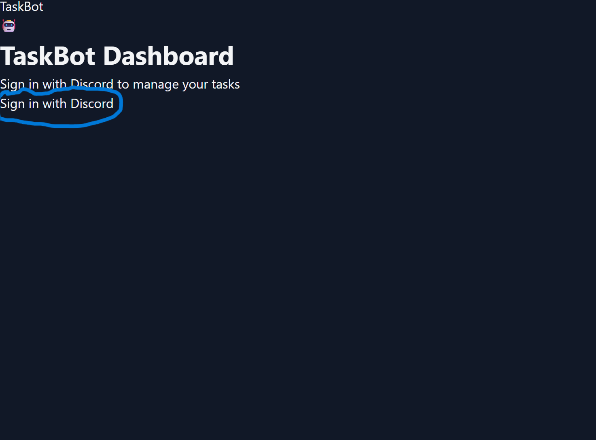
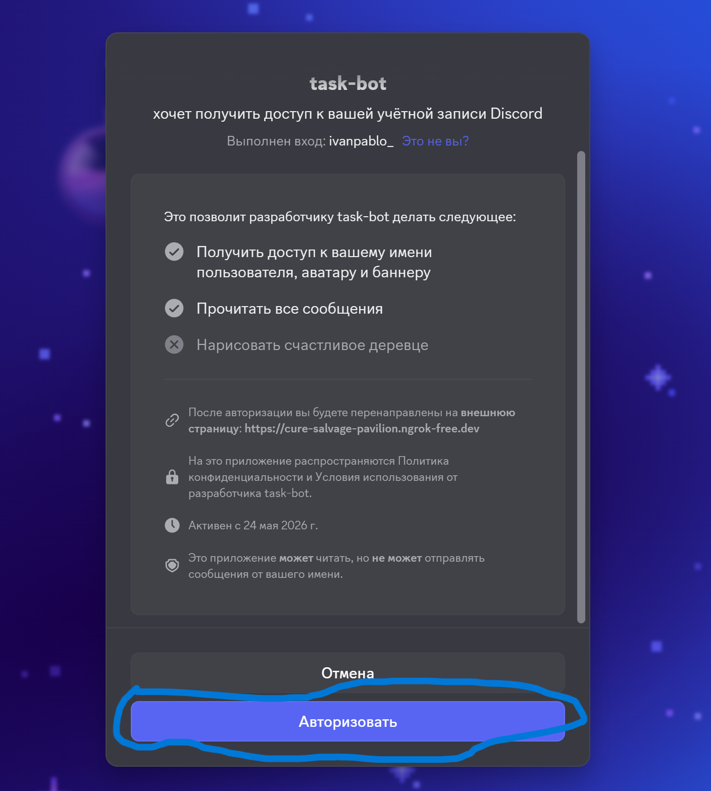
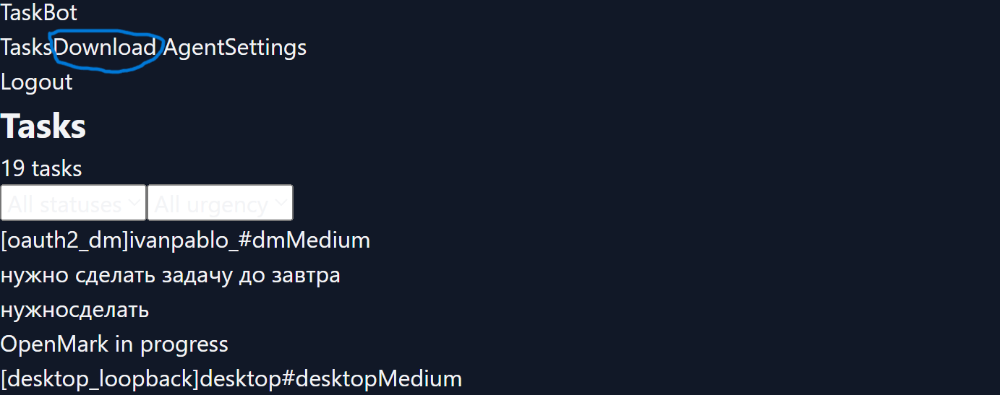
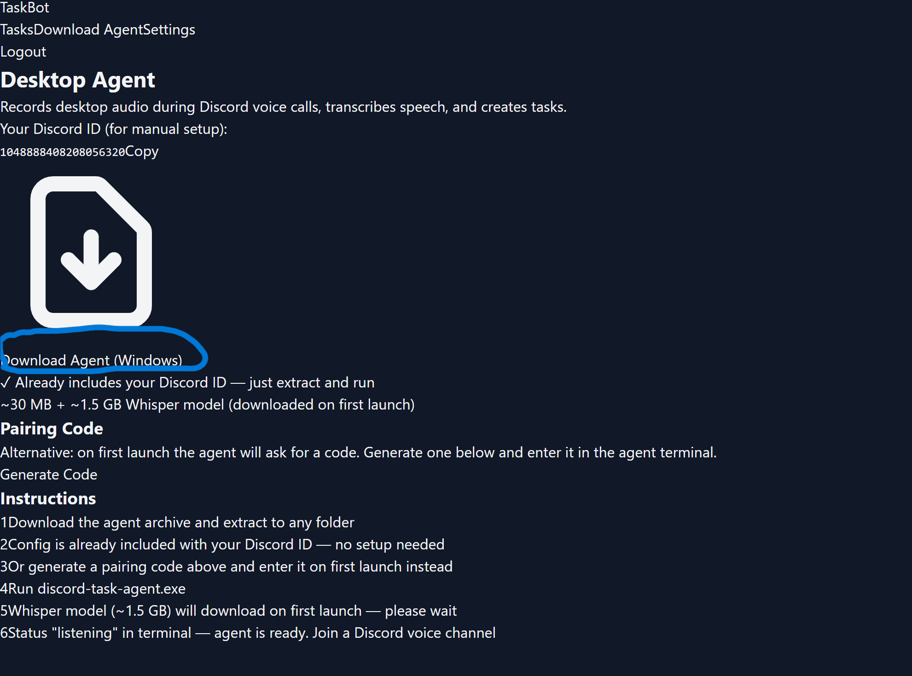
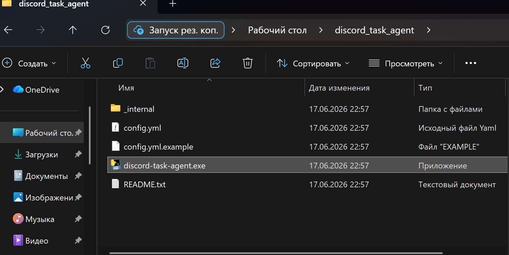
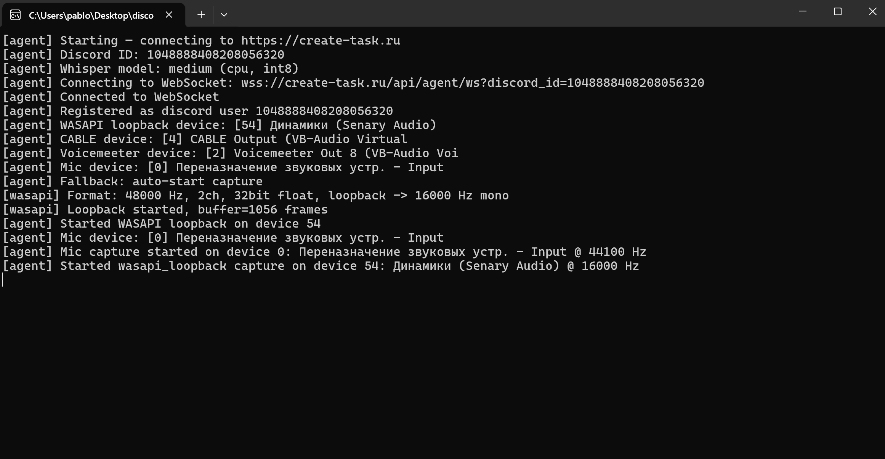

# Discord Task Bot

Извлекает задачи из Discord-сообщений и голосовых звонков, отправляет в ЛС и на веб-дашборд.

---

## Установка Desktop Agent

Агент слушает аудио с микрофона и системного звука, распознаёт речь через Whisper и отправляет транскрипции на сервер. Сервер через LLM (Ollama) выделяет задачи и присылает их вам в личные сообщения Discord.

### Шаг 1 — Авторизуйтесь на сайте

Перейдите по ссылке [https://create-task.ru](https://create-task.ru) и нажмите **Login with Discord**.



### Шаг 2 — Скачайте агента

После авторизации откроется страница загрузки. Ваш Discord ID уже будет указан. Нажмите **Download Agent** — скачается архив `discord-task-agent.zip`.






### Шаг 3 — Распакуйте и запустите

Распакуйте архив в любую папку и запустите `discord-task-agent.exe`.



При первом запуске автоматически скачается модель Whisper **medium** (~1.5 GB) — это может занять 1-3 минуты. После загрузки агент начнёт прослушивание.

### Готово

Агент работает в фоне. Теперь всё, что обсуждается в голосовых каналах, будет транскрибироваться, а задачи из разговоров — приходить вам в ЛС.



> **Примечание:** Агент использует WASAPI loopback для захвата системного аудио. Если в системе не установлен VB-CABLE, агент попытается установить его автоматически или будет использовать микрофон.

---

## О проекте

### Архитектура

```
Пользователь
 ├── Discord Server
 │    └── Discord Bot ──→ NLP ──→ Задачи ──→ ЛС
 │
 ├── Веб-сайт (React + FastAPI)
 │    ├── Авторизация через Discord OAuth2
 │    ├── Скачивание агента (/download)
 │    └── Мониторинг агента (/settings)
 │
 └── Desktop Agent (Windows)
      └── WASAPI loopback → VAD → Whisper STT
           → WebSocket → Ollama LLM → Задачи → DM
```

### Компоненты

| Компонент | Технологии | Назначение |
|-----------|-----------|------------|
| **Discord Bot** | discord.py, NLP (regex) | Слушает сообщения, извлекает задачи, доставляет их в ЛС |
| **API (FastAPI)** | Python, FastAPI, SQLAlchemy | Бэкенд: OAuth2, REST API, WebSocket для агента |
| **Frontend** | React, TypeScript, Vite | Веб-дашборд: авторизация, скачивание, мониторинг |
| **Desktop Agent** | WASAPI, Whisper, Silero VAD | Захват аудио с Windows, распознавание речи |
| **Ollama** | LLM (Qwen/Llama) | Извлекает задачи из транскрипций голосовых звонков |
| **PostgreSQL** | PostgreSQL 16 | Хранение пользователей, задач, сообщений, транскрипций |

### Как это работает

1. **Из сообщений** — бот в реальном времени сканирует сообщения в Discord, находит задачи по ключевым словам (*нужно, сделать, дедлайн, возьму*...) и определяет срочность (high/medium/low)
2. **Из голосовых звонков** — Desktop Agent захватывает аудио (WASAPI loopback), отсекает тишину (Silero VAD), распознаёт речь (Whisper) и передаёт транскрипции на сервер через WebSocket
3. **Обработка звонков** — после паузы в разговоре сервер отправляет накопившиеся транскрипции в Ollama, которая выделяет конкретные задачи
4. **Доставка** — все найденные задачи отправляются в личные сообщения Discord через Embed-сообщения с цветовой маркировкой срочности

### Развёртывание (для разработчиков)

#### Требования
- VPS: 2 vCPU, 4+ GB RAM, 30 GB SSD
- Ubuntu 22.04 / 24.04
- Docker + Docker Compose

#### Быстрый старт

```bash
git clone <репозиторий> /app
cd /app

# Создать .env
cp .env.example .env
nano .env

# Запустить
docker compose up -d

# Скачать модель для Ollama
docker compose exec ollama ollama pull qwen2.5:7b
```

#### Переменные окружения (.env)

| Переменная | Описание |
|-----------|----------|
| `DISCORD_TOKEN` | Токен Discord-бота |
| `DISCORD_CLIENT_ID` | ID приложения Discord |
| `DISCORD_CLIENT_SECRET` | Секрет OAuth2 |
| `DISCORD_REDIRECT_URI` | HTTPS-ссылка на `/auth/callback` |
| `JWT_SECRET` | Случайная строка для подписи сессий |
| `BACKEND_API_KEY` | API-ключ для внутренних запросов |
| `BACKEND_URL` | Публичный URL бэкенда |
| `FRONTEND_URL` | URL фронтенда (для CORS) |
| `OLLAMA_MODEL` | Модель Ollama (qwen2.5:7b, llama3.2:3b) |
| `ALERT_WEBHOOK_URL` | Discord Webhook для уведомлений об ошибках |

### Сборка Desktop Agent (.exe)

Для сборки требуется **Windows** (агент работает только на Windows).

```powershell
cd desktop_agent
.\build_exe.ps1
```

Готовый .exe появится в `desktop_agent/dist/discord-task-agent/`.

После сборки выполните скрипт для создания `base.zip` (используется сервером для скачивания):

```powershell
python scripts/build_base_zip.py
```

Архив `base.zip` появится в `desktop_agent/dist/` — его нужно загрузить на сервер в ту же папку.

### Локальная разработка

```bash
# База данных
docker compose up db -d

# Бэкенд
uvicorn services.web.main:app --reload --port 8000

# Бот
python run.py

# Фронтенд
cd frontend && npm run dev

# Агент (требуется Windows + микрофон)
python desktop_agent/agent.py --local
```
